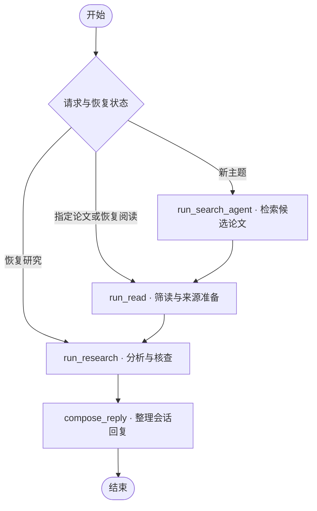

# Paper-Agent

Paper-Agent 是面向科研学生和研究者的论文阅读工作台。给定研究主题，系统可以从 arXiv、OpenAlex 和 Semantic Scholar 检索相关论文。已有目标论文时，也可以通过 API 或 Python 指定论文及其 PDF 链接，直接进入阅读流程。

默认按篇生成阅读报告。报告先讲解研究问题、方法和算法流程，再结合原文分析关键假设、实验支持和结论的适用范围。读者可以沿报告里的证据引用回查原文。允许跨篇分析且至少有两篇可用论文时，可以进一步比较不同工作的主张、实验条件和分歧，或生成综述。为某个证据缺口额外搜索论文由单独的选项控制。

## 技术栈

| 层次 | 技术 | 在阅读任务中的作用 |
| --- | --- | --- |
| 工作台与 API | Vue 3、TypeScript、Vite、FastAPI、SSE | 提交研究任务，查看实时进度和历史报告 |
| 工作流与模型 | Python、LangGraph StateGraph、Pydantic、OpenAI 与 Anthropic 协议适配器 | 路由任务，限定模型输入，校验结构化结果 |
| 论文与证据 | arXiv、OpenAlex、Semantic Scholar、pypdf、PDFium、Pillow | 检索论文，提取文本，按需渲染 PDF 页面供视觉核查 |
| 存储与召回 | SQLite、本地文件、可选 ChromaDB 向量索引 | 保存会话、原文和研究产物，按论文及来源版本召回候选证据 |

## LangGraph 工作流

下图中的四个节点与代码里的注册名称一致。逐篇阅读、复审和跨篇分析由 `run_research` 内部调度。指定论文会跳过检索，恢复任务则按已保存的阶段选择入口。[工作流定义](src/graph/graph.py)



以读一篇算法论文为例，检索节点交出论文标识、题名和来源链接。阅读节点按条件取得全文并切分原文。研究节点先重建方法步骤，解释每步的输入、操作和输出，再用实验段落核查作者的判断。若论文只报告了整套系统的消融结果，单个模块的贡献就需要保留为待验证的推断。最后，会话回复把读者带到逐篇报告及其证据。[研究流程](src/research/workflow.py)

## 架构设计与取舍

- **怎样交接，才能让下一步找回原文？** 检索和研究通过图状态传递论文对象与阅读产物。逐篇任务按论文 ID 取得可见的原文片段，判断记录引用的证据 ID。核查时可以重新读取原文及相邻片段。上下文预算仍会限制一次能读多少，但前一位模型的概括失真时，下一步仍有原始材料可查。[证据范围与上下文](src/research/context.py)
- **哪些职责值得分开？** 不同论文可以分别阅读，草稿和证据复审也需要独立判断。下载、切块、引用匹配和发布条件则交给程序。例如，报告给出可引用的比较句时，程序会检查原文摘录能否匹配、句中是否保留基线和指标。这样可以定位问题出在来源、模型判断还是发布环节。[研究数据结构](src/research/models.py) · [发布规则](src/research/publication.py)
- **什么时候才需要第二篇论文？** 默认每篇独立成报告。`cross_paper_enabled` 控制是否比较已有论文，至少两篇可用才进入比较。`allow_external_search` 单独控制是否针对证据缺口寻找外部论文。因此，“只讲清这篇论文”“查一份外部佐证”“比较两篇已有论文”可以分别表达。[研究选项](src/research/models.py)
- **中断后从哪里继续？** 研究阶段存储检查点和带版本的产物。恢复时核对输入和来源版本，决定哪些结果可以复用。修订一条判断时，依赖关系帮助找出需要复查的比较和段落。[增量依赖](src/research/incremental.py) · [恢复测试](test/test_research_recovery.py)

## 后续改进方向

| 想解决的问题 | 改进方案 | 如何判断有效 |
| --- | --- | --- |
| 报告能列出步骤，学生却难以复述方法 | 用专家标注的真实论文分别评估输入输出、关键假设和实验归因 | 分项统计步骤遗漏和缺少证据的因果判断 |
| 证据 ID 有效，关键限定条件仍可能在交接时丢失 | 用指标、基线和消融条件分布在不同段落的样例，对比不同上下文预算 | 同时记录限定条件保留率、核查通过率和模型调用成本 |

## 本地运行

准备 Python 3.12、uv 和 Node.js 22，在仓库根目录执行以下命令。前端构建完成后由 FastAPI 一起提供服务。

```sh
uv sync --locked
npm ci --prefix front
npm run front:build
uv run --locked python main.py
```

打开 [本地工作台](http://127.0.0.1:8000/)，在「系统设置」中填写模型服务地址、模型名称和凭据，测试连接后保存，再进入会话页提交研究主题。会话页可查看任务进度、历史记录和报告。

也可以参照 [模型配置示例](config/model.example.json) 创建本地 `config/model.json`。在 `agents.default_agent` 指定模型和对应的 Provider。如果密钥放在项目根目录的 `.env` 中，在 Provider 的 `api_key_env` 填写变量名，然后使用以下启动命令。向量检索可另行配置 embedding，未配置时仍可按原文片段阅读与核查。

```sh
uv run --locked --env-file .env python main.py
```

在阅读任务中，「图文检索模型」默认选择本地 GME-Qwen2-VL-2B，也可选择 CLIP 或关闭。需要同时使用两种模型时，用 `uv run --locked --extra gme --extra image-retrieval python main.py` 启动。GME 权重默认读取 `/data/models/liveact/qwen-vl/gme-Qwen2-VL-2B-Instruct`，可通过 `PAPER_AGENT_GME_DIR` 指定其他目录。模型仅在需要按图检索时加载。[模型配置与实测结果](docs/jit-multimodal-pdf-retrieval-design.md#13-当前实现状态)

文本向量索引与图文检索独立配置：正文可通过 `embedding_profiles` 接入向量服务，或用 `PAPER_AGENT_TEXT_E5_DIR` 指定本地 multilingual-e5-small。未配置时仍使用文本与结构检索，不影响按需调用 GME。报告分别记录文本检索状态和图文检索的关闭、未触发、无候选、失败或已完成状态。

`research_max_calls` 限制模型调用次数，`research_timeout_seconds` 限制研究阶段总时长。启用推理且总时长超过 60 秒时，逐条阅读为最终规划、讲解和复审预留三分之一时间（最多 600 秒）；这不是完成保证。超时、预算耗尽和调用/输出错误记为“未完成核查”，与已完成核查后得出的“证据不足”区分。结构化结果通过 `execution_status` 表达执行状态，原 `verdict` 字段保留以兼容已有消费者；统计证据结论时应只计 `execution_status=completed` 的记录。

## 使用入口

| 场景 | 入口 |
| --- | --- |
| 交互式阅读 | 本地工作台提交主题并查看报告 |
| 接入已有应用 | [本地 API 文档](http://127.0.0.1:8000/docs) 提供会话、任务和设置接口 |
| 在脚本中分析指定论文 | 构造 `ResearchRequest`，在 `constraints.papers` 中传入含 `id`、`title`、`pdf_url` 的条目，然后调用 [run_graph_sync](src/graph/graph.py) |

## 开发与测试

开发前端时，保持后端运行，在另一个终端执行 `npm run front:dev`，打开 [前端开发页](http://127.0.0.1:5173/)。提交改动前可运行后端测试和前端类型检查及构建。

```sh
uv run --locked python -m unittest discover -s test
npm run front:build
```

## 项目来源与致谢

本项目参考并沿用了 Tswoen/Paper-Agent 的代码，在其代码库基础上继续开发。感谢 Tswoen 和上游贡献者实现论文检索、全文阅读、模型配置和会话工作台，也感谢他们在全文提取校验、相关性筛选和任务中断恢复上的投入。[上游项目](https://github.com/Tswoen/Paper-Agent)
