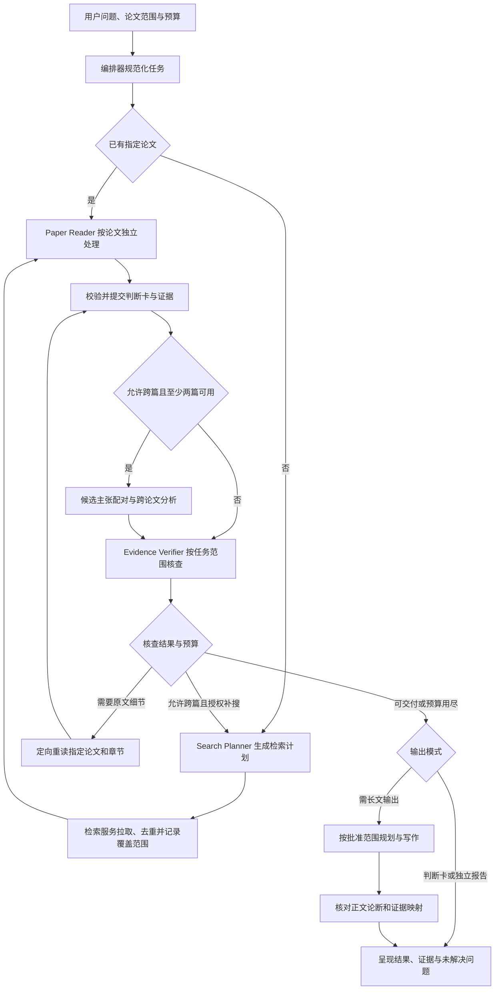

# 多 Agent 架构：现状、拆分依据与交接契约

 > 状态：新研究流程已接入，旧 Analyse → Outline → Writing 流水线及兼容路由已删除。第 3～12 节包含目标设计，第 13 节说明已实现范围与限制。

## 1. 拆分依据

独立角色来自可并行工作、上下文隔离或校验责任差异，而不是每个步骤都包装一个 Agent。逐篇 Reader 可并行，Verifier 独立核查，跨篇 Analyst 按需调用；下载、切块、持久化和报告拼接是普通工程步骤。

## 2. 实际交接方式

图只有检索、来源准备、研究、回复四个节点。指定论文时跳过检索。角色之间不共享聊天历史；编排器传递版本化对象与原文引用，并按允许的论文 ID 装配各次模型上下文。

| 阶段 | 交付内容 | 下游使用 |
| --- | --- | --- |
| Search | 论文元数据和检索结果 | 来源准备执行摘要筛选、下载、解析与分块 |
| 来源准备 | 原文 chunk、页码、来源路径 | Reader 在单篇范围内逐批读取原文 |
| Reader | Claim、前提、实验条件、EvidenceSpan 引用 | Verifier 回查原文并记录目标版本 |
| 可选 Analyst | 两个主张之间的关系与证据 | Verifier 核查关系和可比条件 |
| 可选 Writer | 引用已核查主张的段落 | 段落再次核查后生成报告 |

结构化抽取仍可能遗漏信息；原文不会由摘要替换，预算导致的未读片段显式记录。范围与引用校验由代码执行。

## 3. 推荐的最小角色划分

| 角色 | 边界与职责 | 拆分理由 |
| --- | --- | --- |
| Search Planner | 将研究问题拆成检索策略；基于证据缺口决定补搜。实际查询由检索服务执行 | 查询规划与证据处理使用不同输入和工具 |
| Paper Reader | 同一种工作单元按论文并行运行；抽取论文主张、前提、方法、实验条件和证据位置 | 可并行、上下文可按论文隔离 |
| Cross-paper Analyst（可选） | 用户要求跨论文分析且有至少两篇可用论文时，对齐研究问题与实验条件，形成支持、差异、冲突和同质关系 | 仅跨篇任务需要该上下文；单篇或逐篇独立报告跳过 |
| Evidence Verifier（按范围运行） | 单篇模式核查抽取是否忠于原文、前提与实验是否支持报告判断；跨篇模式额外核查关系与可比条件 | 核查与生成职责分开；共用核查能力，不要求拆成两个 Agent |

编排器、去重、下载、存储、字段校验和状态转换仍是普通程序。Writing Outline 可以是按需的规划步骤；Writing 只有在用户请求综述或其他长文时才启动。这里的“并行 Paper Reader”表示同一角色处理多篇论文，并不要求每篇论文拥有不同的 Agent 实现或长期记忆。

单篇阅读本身是完整任务：Reader 形成判断卡，Verifier 在该论文内核查，随后生成单篇阅读报告。多篇输入也可以逐篇独立处理、各出一份报告；论文数量不构成启用 Cross-paper Analyst 的理由。简单报告可由模板呈现已核查的判断卡，需要长篇解释时才调用 Writer。

## 4. 交接契约：共享研究对象，不传聊天摘要

每个阶段应写入版本化的结构化对象，而不是只交给下一阶段一段自然语言总结。最小契约包括：

```text
PaperRecord: paper_id、版本/DOI、来源、全文状态
EvidenceSpan: evidence_id、paper_id、原文位置、原文片段、解析版本
Claim: claim_id、paper_id、主张、前提/适用范围、evidence_ids、状态
AnalysisRelation（仅跨篇分支）: relation_id、claim_ids、关系类型、比较维度、理由、evidence_ids、核查状态
VerificationResult: target_type、target_id、target_version、scope、evidence_ids、verdict、reason、repair_request
```

模型提示词可只携带相关对象的简要视图和稳定 ID；需要判断冲突或核查时，必须能通过 ID 回取原文。压缩只改变**本次阅读视图**，不能抹掉证据、前提、来源和处理版本。缺失字段应标为 `unknown`，不可当作“论文没有报告”。

推荐的执行路径：

```text
研究问题或指定论文 → 获取论文 → 单篇阅读（多篇可并行）→ 判断卡与证据
  ├─ 单篇／不跨篇比较 → 逐篇原文核查 → 每篇独立阅读报告
  └─ 要求跨篇分析且至少两篇可用 → 跨篇分析 → 关系核查 → 比较报告或综述
```

每次核查失败应能返回具体 `claim_id` 或 `relation_id` 及失败原因，触发针对性重读或补搜，而不是让整个链条重新概括一遍。

## 5. 如何判断拆分是否真的有效

在同一批论文和相同模型预算下，对照“现有串行多 Agent”“合并分析与大纲的简化流程”“带原文回查的结构化交接流程”。评估：

- 关键结论能否定位到真实原文；原文是否支持该结论。
- 实验条件、负面结果和限定语的保留率。
- 同质论文、条件差异和真实冲突的判定准确率。
- 运行时间、模型调用次数、token 成本与失败恢复成本。

只有新增角色带来可测的质量、并行或隔离收益，才继续保留该拆分。相关的跨论文对象与核查规则见 [对抗与多论文分析设计](./adversarial-multi-paper-analysis.md)。

## 6. 规划方法与决策顺序

实施时按以下顺序做决策，避免先建立一套角色再寻找用途：

1. 明确输出：`paper_cards`（判断卡）、`paper_report`（每篇独立阅读报告）、`comparison`（跨篇比较）、`review`（综述）；另设 `cross_paper_enabled` 表达是否允许跨篇分析，输出形式与分析范围分别控制。
2. 定义验收样例：选取包含条件差异、真实冲突、同质方法、全文缺失的论文组合，人工标注原文证据与关系。
3. 定义数据契约和状态转换，然后实现证据回查；Agent 的输入输出必须落在这些契约上。
4. 先完成单篇 Reader、独立核查和报告，再扩展逐篇并行；之后接入可选跨篇分析。
5. 用质量与成本对照实验决定是否保留每一个独立角色，最后接入写作和前端。

这是一套拟议工作流，不要求所有角色持续运行，也不要求使用不同模型。独立核查的价值来自重新读取来源和独立的判断标准；更换模型只是一种可评估的选项。

新任务默认采用 `paper_report`、`cross_paper_enabled=false`。明确要求比较、冲突辨析或跨文献综合的任务才将开关设为 true；用户明确“不跨篇比较”优先于自动识别的任务类型。`comparison` 与禁用开关冲突时，规范化为逐篇报告并说明调整。API 缺少任务字段时同样默认逐篇报告，禁用跨篇。

编排器只有在开关为 true 且至少两篇论文可用时才调度 Analyst。单篇或处理失败后仅剩一篇时，交付单篇报告并说明比较条件不足；不为凑齐篇数擅自补搜。禁用跨篇时，`AnalysisRelation` 和关系核查属于不适用项，允许缺省，不阻塞报告生成；Writer 也不能在末端自行做跨篇综合。综述请求同时禁止跨篇时，输出逐篇报告汇编，并说明其组织方式。

## 7. 完整执行流程与分支



图中的回边由普通编排代码依据结构化状态选择。Agent 可以提出重读或补搜请求，但不能绕过预算、重复任务检查和提交校验。

单篇或禁用跨篇模式中，核查者只在当前论文内检查前提、实验和结论，不补搜外部反例。获取指定论文缺失的全文属于资料获取，不代表获准扩展论文范围。每篇报告的上下文和证据引用限定在该论文内。

第一版建议将 `max_repair_rounds` 和 `max_search_rounds` 都设为 1，作为可调整的工程初值；同时配置每轮论文数、模型调用数、token 预算和总时长。预算用尽后输出已完成部分与未解决问题，不能把未核查结果改标为已核查。用户取消在等待点和阶段提交前生效。

全文不可用时保留摘要级判断卡，相关实验条件标记未知；单篇失败不取消其他论文。模型服务整体不可用时暂停任务并保存恢复状态，避免反复重试消耗预算。

## 8. 每个角色的上下文、工具与写入边界

| 角色 | 本次模型上下文 | 可调用能力 | 允许提交 |
| --- | --- | --- | --- |
| Search Planner | 问题、约束、既有检索覆盖、明确的证据缺口 | 查询规划；请求检索服务 | `SearchPlan`、补搜请求 |
| Paper Reader | 单篇元数据、原文/章节、抽取规范、定向核查反馈 | 读取指定论文全文、章节、图表定位 | `PaperCard`、`Claim`、`EvidenceSpan` 草稿 |
| Cross-paper Analyst（可选） | 开关启用后，同一问题下的主张、条件、来源等级、候选关系 | 回查候选论文原文；在任务范围内请求补读/补搜 | `AnalysisRelation` 草稿、`EvidenceGap` |
| Evidence Verifier | 待核查对象及版本、scope、允许读取的论文 ID、原文及邻近上下文；跨篇模式增加关系和条件对齐结果 | scope=paper 时只读取当前论文；scope=cross_paper 时读取指定关系的论文，并可在授权范围提出补搜请求 | `VerificationResult`、定向修订请求；不直接改写 Reader 或 Analyst 的结果 |
| Writer（可选） | 写作任务、核查后的主张和关系、必要的前文 | 回查证据；提出内容缺口 | 带 claim/evidence ID 的正文草稿 |

工具白名单在调用分发器校验，写入对象由服务层校验；仅在 prompt 中禁止某项操作不构成权限约束。第一版无需引入独立进程沙箱。所有角色经统一服务写入仓储，不直接改写其他角色的结果。

核查者可以看到待核查结论，但应先检查原始证据再提交结果；生成者的解释不能替代来源。对同一对象可以有多次核查，保留各次输入版本和结果。

### 8.1 Verifier 的两种核查范围

`scope=paper` 是单篇任务的基础核查：检查抽取、数字和限定语是否忠于原文，报告判断是否符合文中实验条件，是否遗漏会改变结论的局限。核查者可挑战作者的推论，但必须区分“作者确实这样报告”与“实验足以支持该推论”。它不证明论文结论在现实世界中成立，也不负责确认领域新颖性。多篇独立报告分别调用该范围，不能读取其他论文或历史会话中的外部证据。

`scope=cross_paper` 只在跨篇分支启用且存在待核查关系时运行：读取关系涉及的论文，检查同质、支持或冲突判断及实验条件对齐。可以复用目标版本未变化的单篇核查结果；若支撑关系的 Claim 尚未核查，先补做单篇核查。缺少跨篇关系时，不创建空核查任务。

两种范围共用一个核查角色、结果契约和回查工具，由编排器选择范围；单篇核查不会随 Cross-paper Analyst 一起关闭。原文定位、ID 和版本等确定性检查由程序执行，语义支持和条件遗漏由独立模型调用检查。独立核查是一次有明确输入和范围的工作单元，无需常驻对话或两个新 Agent。

`VerificationResult` 按对象输出结论、原因、使用过的证据及修订要求，另记录实际来源等级和未检查项。`verified` 仅表示本次范围内有证据支持，不代表整篇论文或整个研究领域获认证。来源无法读取时标记 `insufficient_evidence` 或等待资源，不能视为通过；`qualified` 必须记录应补充的限定条件，并核查修订后的对象版本。

单篇问题退回 Reader 定向重读；关系问题退回 Analyst 重新对齐；最终正文歪曲已核查对象时退回 Writer。补搜必须符合任务范围及预算。未完成核查的报告可作为明确标注状态的阶段产物交付，不能展示为已核查报告。

## 9. 上下文装配与 handoff 的具体规则

每次调用由 Context Builder 生成可追踪的输入包：

```text
task_id / run_id / role / schema_version
question / constraints / output_mode / cross_paper_enabled / allowed_paper_ids / budget_remaining
input_refs: [{object_id, object_version}]
required_facts: 主张、前提、实验设置、来源等级、已知反例
evidence_refs / retrieval_tools
omitted_refs / unresolved_questions
```

优先携带决定判断的事实与来源，长正文通过工具读取。模型上下文超限时，将任务按主张组或论文拆小；必须记录未纳入本次上下文的对象。禁止将 JSON 截成字符串后继续当作完整事实；禁止把截断后的内容当作完整原文。正文分块应保留章节、段落顺序与邻近片段，跨块前提需要显式补读。

共享仓储保留完整结果；State 主要保存 ID、对象版本、执行状态与预算。提示词中的简述是可重建视图。接收方必须校验引用对象存在、版本匹配、证据位置可解析。校验成功仅代表结构和来源可定位，语义支持关系仍需核查。

跨篇分支启用后，关系候选可先用问题、方法和条件字段筛选，再用向量相似度补充候选。候选检索只减少比较量，不能直接判定关系；保留候选生成规则和抽样漏检检查，避免全量论文两两比较的成本失控。禁用跨篇时不生成候选关系，不调用 Analyst；上下文装配器和工具分发器都按当前论文限制读取范围。

## 10. 存储、并发和恢复

- SQLite 保存对象索引、版本、依赖和任务状态；原文、图表及长文本沿用文件存储。Chroma 可用于候选召回，不充当事实来源。
- Reader 工作单元互相不写同一结果；先产出局部结果，再由仓储事务提交。按 Provider、下载和论文任务分别设置并发限额，复用现有资源管理层。
- 幂等键至少包括论文版本、解析版本、抽取规范版本、模型/提示词版本；任务相关视图另外绑定问题版本。基础抽取缓存与“本轮是否相关”的判断分开，避免一次无关判定污染其他研究主题。
- 对象提交后记录下游依赖。论文或 Claim 更新时，对应关系、核查和正文标为过期，仅重算受影响部分。
- 持久化区分 `pending/running/completed/failed/cancelled` 等执行状态，与 `verified/qualified/insufficient_evidence` 等内容状态。任务执行完成不等于研究结论已核查。
- 保存每个工作单元的输入引用、提交结果和预算消耗。重启后将无执行句柄的 running 任务对账为中断，再从最后一次稳定提交恢复；不假定现有阅读恢复能力已经覆盖新对象。

## 11. 对现有代码的迁移计划

以下路径是改造落点，不表示文件已按该方案实现。

| 阶段 | 主要落点 | 交付物与完成条件 |
| --- | --- | --- |
| P0：基线 | `test/`、当前各阶段产物 | 固定离线样例与人工标签；记录当前质量、时间和成本 |
| P1：对象与仓储 | `src/models/`、`src/repositories/` | Claim、EvidenceSpan、关系及核查模型；版本、引用与幂等校验通过 |
| P2：阅读改造 | `src/graph/read_node.py`、`src/utils/read_utils/` | 并行 Reader 产出判断卡；全文与摘要等级明确；保留旧 read_results 适配 |
| P3：交接与可选分析 | `src/research/context.py`、`src/research/workflow.py` | 单篇路径可独立交付；跨篇路径按开关与篇数调度，按引用回查原文 |
| P4：核查与回路 | 拟新增 Verifier；`src/graph/graph.py` | paper/cross_paper 两种范围；按问题退回 Reader/Analyst/Writer；受限补搜、预算停止和版本化结果 |
| P5：任务与输出 | `src/services/paper_workflow_runtime.py`、`src/models/protocol.py`、写作节点 | 支持四种输出及独立跨篇开关；新任务默认单篇报告，旧请求由适配器兼容；正文保留内部 claim/evidence 映射 |
| P6：工作台与对照 | `front/src/`、`test/` | 显示判断卡、证据、关系和未解决问题；质量及成本对照完成 |

当前迁移已经完成：保留现有会话、SSE 与历史产物读取，新任务统一进入新研究图。旧 Analyse/Outline/Writing 图已删除，不再提供隐式回退；回滚须使用版本控制，不删除既有研究数据。

验收包含：引用与版本校验、重跑幂等、并发写入、取消与重启恢复、模型失败、工具不可用、预算耗尽和跨论文人工评估。离线测试使用固定文档与模型替身；真实模型评估单独启用并记录模型版本。结构验收不能证明学术判断正确，后者以人工标注和盲审为准。

路由验收至少覆盖：单篇输入；多篇但禁止比较；多篇且明确要求比较；比较任务因失败仅剩一篇；综述要求与禁止跨篇约束同时出现。前三种应分别得到一份独立报告、多份独立报告、跨篇报告。所有禁用跨篇的案例都应断言 Analyst 调用次数为零，并检查单篇报告未引用其他论文。

Verifier 验收额外覆盖：单篇核查仍被调用；越界论文读取和外部反证查询被工具层拒绝；无关系时跨篇核查次数为零；Claim 修订使旧核查过期；原文不可用不能通过；摘要来源不能被标记为全文核查。核查成本与发现错误的收益也纳入角色拆分对照。

## 12. 第一轮实施范围

第一轮优先完成“单篇阅读 → 判断卡 → 原文核查 → 单篇报告”的完整闭环，并验证多篇独立并行、逐篇交付。第二步再用同一问题下两到五篇论文验证可选的“条件对齐 → 关系草稿 → 关系核查 → 比较报告”。复杂图表、跨领域质量总分和自动实验执行不作为这轮验收条件。具体分析字段、关系语义与评分原则沿用 [对抗与多论文分析设计](./adversarial-multi-paper-analysis.md)。

## 13. 本次实现与使用

所有入口均使用新研究流程。前端与 API 默认逐篇报告、关闭跨篇；缺少任务字段不会进入旧综述路径。

```json
{
  "content": "分析这篇论文的成立前提和实验依据",
  "constraints": {
    "output_mode": "paper_report",
    "cross_paper_enabled": false,
    "papers": [{"id": "example-paper", "title": "Example Paper", "abstract": "论文摘要", "pdf_url": "https://example.org/paper.pdf"}]
  }
}
```

该结构可提交至 `/api/sessions/{session_key}/runs` 或同步的 `/messages`。示例 URL 需替换为真实论文地址；省略 `papers` 时沿用多来源检索。`papers` 目前由 API 提供，网页提供主题检索和任务选项。`paper_cards` 生成简要卡片；`paper_report` 生成含原文依据的独立报告；`comparison` 在启用跨篇且资料足够时生成关系分析；`review` 在相同条件下额外调用 Writer，并逐段核查正文。

实现模块：

- `src/research/models.py`：严格输入、Claim、EvidenceSpan、关系、核查与正文对象。
- `src/research/context.py`：允许论文集合、原文回查、邻近片段及无截断分批。
- `src/research/agents.py`：独立 Reader、Analyst、Verifier、Writer 模型任务；调用次数、超时及并发上限。
- `src/research/storage.py`：复用 SQLite 会话产物索引保存版本化对象和原文证据。
- `src/research/workflow.py`：并行逐篇处理、修订和重新核查、可选关系分析、报告生成。
- `src/graph/graph.py`：统一研究路由、指定论文入口及研究恢复入口。

来源准备 Read 节点只负责摘要筛选和全文准备，完成分块后交给新 Reader，删除旧六字段提取与核查，避免重复抽取与压缩交接。跨篇关闭时也禁止旧精读名额分配调用批量比较模型。单篇报告、完整研究对象及最终报告分别保存为 `paper_report`、`research_state`、`final_report` 产物。

研究入口保存包含原始阅读结果的恢复现场；现有 `resume_from_last_checkpoint` 可直接恢复研究阶段。每篇完成后持久化判断与核查历史；仅复用原文、问题、模型和处理版本匹配且核查通过的结果。未通过或被修改的对象重新执行，不将旧通过状态应用到新版本。

预算选项为 `research_max_calls`（默认 80）、`research_max_repair_rounds`（默认 1）、`research_timeout_seconds`（默认 600）和 `research_context_chars`（默认 24000）。这些约束针对新研究阶段，前置检索与下载仍使用已有配置。预算耗尽保留未核查状态与遗漏证据列表，交付阶段报告。正文写作仅使用已通过核查的主张，生成后再次核查。

候选比较包含不同论文的同类主张，以及结果、前提、局限、方法之间的交叉主张对，受调用预算限制并记录遗漏数量。关系必须经过逐轴对齐与独立核查。受限外部补搜、分维度评价、交互关系图及人工修订重核查已接入，详见对抗分析文档第 7 节。图表/扫描页视觉读取和核查、人工修订的依赖增量复用已接入，另有真实论文标注与评测工具，详见 [补齐能力说明](./visual-evaluation-incremental.md)。这些能力不新增常驻 Agent。配置中的 context_chars 是字符预算，不等同于精确 token 计数，需按实际模型窗口调整。

验证使用离线模型替身和临时 SQLite：包括范围隔离、可选路由、条件修订、版本失效、预算用尽、研究恢复、API 校验及下载。真实模型质量与学术正确性需配置本地 Provider 后另行评估。测试命令为 `uv run --locked python -m unittest discover -s test -v`；真实模型测试仅在显式环境开关开启时运行。

向量入库与召回已接入新研究流程：有全文且配置了 embedding profile 时，`src/research/retrieval.py` 将版本化原文片段写入 ChromaDB。Reader 优先读取召回片段，但仍分批覆盖全部原文；Verifier 和可选 Analyst 召回补充证据后回查当前版本原文。数据库查询和返回值校验均限制论文范围。模型与维度采用独立集合，原文版本采用独立索引范围，重复运行复用已入库片段。配置沿用 `read.vector_store_path`、`read.vector_store_collection` 和现有 embedding profile；未配置或调用失败时回退到原文阅读，并在报告 `retrieval` 中记录原因与实际用量。检索只提供候选证据，不代表核查通过。

深度代码审查的删除依据、证据完整性修复与回归结果见 [架构清理复核](./architecture-cleanup-audit.md#深度审查结论)。旧 Agent 注册/技能/环境空壳已删除；具体工具接口与 Chroma 基础设施保留。

深度审查修复：来源文档和读取覆盖进入失效依赖；Writer 消费通过核查的跨篇关系；反证补搜在逐篇核查后围绕具体挑战执行。关系对按结构化条件优先并跨论文对轮转。详见 [修复及测试说明](./visual-evaluation-incremental.md#5-深度审查后的修复当前-schema_version4)。
