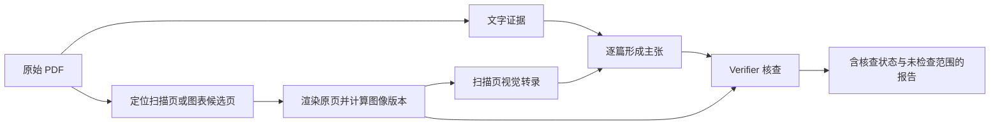
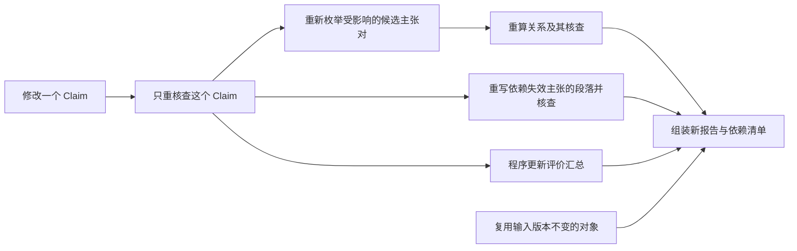

# 视觉证据、真实论文评测与增量更新

这三项已经接入现有研究流程，不增加常驻 Agent。视觉转录与核查共用研究调用预算；增量调度和评测统计由普通程序完成。跨篇分析仍由用户开关控制，单篇报告不调用跨篇分析任务。

## 1. 图表和扫描 PDF 在哪里起作用



- `src/research/visual.py` 使用 PDFium 渲染 PNG，识别缺少文字及含图表引用的候选页；扫描页通过配置的研究模型做视觉转录。转录保留原页、图像版本和不确定项。它不是经过独立认证的 OCR 真值。
- `agents.verify` 把当前论文范围内的原图直接附给 Verifier。核查要求检查坐标轴、数值、单位、图例、表注等，不能只相信转录。跨篇核查也只能取得该主张对允许访问的论文原页。
- 使用 OpenAI 兼容的图像消息，Anthropic 适配器转换为原生 image block。研究模型需要支持图像；不支持或返回错误时保留未完成状态，不宣称视觉核查通过。
- 没有匹配原图、未知页码或单次图像预算不足时，原本的 verified 降为 needs_human_review，依赖视觉的维度分值记 unknown。转录失败和未处理页计入阅读遗漏，不能按完整阅读生成论文总分。
- 报告保存页码、源文件/图像版本、视觉核查实际输入和遗漏范围；图像二进制只保存在本次任务内存中，不写入报告 JSON 或向量索引。原 PDF 仍使用既有本地缓存。Chroma 继续索引有来源的文字与转录证据。

配置放在运行请求的 `constraints` 中，网页也提供设置：

```json
{"visual_verification": true, "visual_page_limit": 6}
```

默认每篇最多准备 6 个候选页，可设 1–20；每轮最多准备 24 张原页，单次核查最多附 4 张原页，单页长边最多 1800 像素。候选识别最多检查前 500 页，文件上限 50 MB；超出范围显式记录。PDFium 原生操作串行化，防止线程不安全。候选页按图表编号、扫描特征及图注优先选择，并为后续论文保留预算；仍可能遗漏没有文字图注的复杂图形；这不是全自动视觉完整性认证。更细的局部裁剪和表格结构恢复可后续添加。

## 2. 真实论文评测如何使用

`evaluation/real-papers.json` 是 4 篇真实论文的 9 个小型回归样例，保留版本化的官方来源 URL、章节定位、短原文摘录、主张、参考标签及理由。来源为：

- [Attention Is All You Need，§3.1](https://arxiv.org/html/1706.03762v7#S3.SS1)
- [Pure Attention Loses Rank，摘要](https://arxiv.org/abs/2103.03404v2)
- [BERT，摘要](https://arxiv.org/abs/1810.04805v2)
- [Transformer-XL，摘要](https://arxiv.org/abs/1901.02860v3)

样例检查忠实转述、遗漏前提、证据不足和错误认定论文关系。**当前参考标签是 AI 根据来源整理的待审草案，专家确认样例数为 0。** 不能把离线测试通过或草案命中率写成真实学术准确率。该小集合也不足以衡量完整论文的覆盖率、领域新颖性、视觉误差率或评分校准。

```bash
# 无需模型：校验来源、主张范围、标签和样例 ID
uv run --locked python -m src.research.evaluation validate --split all

# 输出空白人工审阅模板，不预填参考答案，避免默认接受草案
uv run --locked python -m src.research.evaluation review-template --split all --output /tmp/paper-reviews.json

# 使用本地配置的真实模型，实际调用生产 Verifier / Analyst
uv run --locked python -m src.research.evaluation run --split development --output /tmp/paper-predictions.json

# 计算参考草案成绩；没有人工数据时专家成绩为空
uv run --locked python -m src.research.evaluation score --predictions /tmp/paper-predictions.json

# 加入人工审阅文件，并验证版本、来源范围和审阅者唯一性
uv run --locked python -m src.research.evaluation validate --split all --reviews /tmp/paper-reviews.json
uv run --locked python -m src.research.evaluation score --predictions /tmp/paper-predictions.json --reviews /tmp/paper-reviews.json
```

输出文件用独占创建，避免覆盖既有预测或标注。模型输入只含主张与证据，不含期望标签、标注理由或其他样例。默认只运行 development；holdout 需显式指定，供人工锁定测试集使用。当前按论文族划分 development / holdout，仍应在正式实验前扩大并冻结集合。

人工标注字段：`case_id`、`case_version`、`reviewer`、`expertise`、`reviewed_at`、`origin=human`、`source_ids`、`labels`、`rationale`。每位专家应独立核查完整来源并填写模板，再将记录合并到 JSON 数组；至少两位不同审阅者的同维度标签全部一致，才进入 `expert_consensus`。单人标注或分歧保留在 unresolved 列表，不能被多数票或 AI 自动裁决隐藏。样例或原文发生变化后旧标注和预测失效。同一人重复提交会报错；身份与专业资格由组织者确认，CLI 不提供身份认证。

输出按草案和专家共识分开，包含各维度 accuracy、macro-F1、错误冲突数量、完成数量；缺失预测计错误，不通过删掉难例提高成绩。`run` 的 API 调用成本和模型签名保留在预测中。人工标注流程和离线统计可测试，但真实专家评测必须有实际专家参与。

## 3. 增量调度如何工作

当前增量入口是网页/接口的**人工主张修订**。原有 `POST /api/sessions/{session_key}/research/revisions` 保持不变。新运行从当前会话的父报告读取不可变对象，不把上一个 Agent 的压缩上下文交给下一个 Agent。



`src/research/incremental.py` 判断哪些结果仍然有效：

1. 先核对执行策略，包括模型签名、问题、上下文预算、修订规则、视觉设置和检索集合。策略变化不沿用旧核查。
2. 核对论文全部证据版本。Verifier 会独立检索内部反证，因此其依赖是允许访问的整篇证据集合，不能仅检查最终引用的两段文字。来源变化的论文不能复用核查。
3. 未改论文复用判断卡；同一被修改论文内，未变主张复用其核查。原始修订目标来源变化时仍拒绝陈旧修订，要求基于新来源重新阅读。
4. 对所有当前候选对进行枚举；主张和单篇核查版本均不变的对复用关系与核查，包含已完成但没有关系的空结果。新主张对和涉及改动主张的对重新计算，避免只沿旧关系图寻找依赖而漏掉新冲突。
5. 无关正文及其核查直接保留。失效段落按其所需完整主张范围重写，新增或未覆盖主张进入写作。Writer 当前输入包含通过核查的关系，段落依赖 Claim、相关关系及其核查版本；变化的关系会使对应段落失效。
6. 评价汇总、矩阵、图和 Markdown 由普通程序重组，不为这些廉价步骤额外调用模型。旧版本报告保持不变。

`research_state` 的 schema_version 为 4，新增 `source_manifests`、`execution_policy`、`dependencies`、`pair_outcomes`、`incremental` 和 `visual`。旧产物缺少依赖元数据时安全退化为重算。模型调用失败的核查和不完整阅读不能当作完整缓存复用。源图一致且模型一致的扫描转录可复用，核查仍绑定原页。

这里的“最小范围”是**依据当前明确输入依赖，尽量避免重复模型调用**；不是任意代码或外部系统的通用 DAG 调度器。新建任务仍通过既有逐篇缓存复用；尚无任意文件变更自动触发更新、跨会话缓存合并或实验复现调度。

## 4. 验证边界

新增测试使用真实 PDF 渲染器、程序生成的扫描 PDF、实际会话数据库和模型替身，验证图像传递/页数限制/缺图降级/损坏 PDF/视觉版本失效/跨论文隔离、人工共识与陈旧标注、生产核查函数接入，以及跨篇开关和增量调用范围。

这些测试不证明真实多模态模型能正确读懂每张图，也不代替人工专家的标签。真实模型评测命令需要可用的本地研究模型配置；未配置时明确报错，不生成虚假的成绩。

本轮测试：`uv run --locked python -m unittest discover -s test` 共 123 项，119 项通过，4 项真实服务测试按开关跳过。前端类型检查、Vite 构建及 `uv pip check` 通过。真实模型评测命令因本地未加载到可用研究模型而明确退出，未产生真实模型成绩。

## 5. 深度审查后的修复（当前 schema_version=4）

上一版本的“接入”不代表质量闭环完整。本次针对审查发现的具体问题作了以下修复：

| 问题 | 当前处理 | 验证方式 |
| --- | --- | --- |
| PDF 新增未读页，但旧判断卡仍复用 | `source_manifests` 同时记录原文件/Markdown 指纹、证据版本、视觉读取范围和失败状态。整篇来源变化使判断与核查失效；像素未变的单页转录仍能复用 | 真实扫描 PDF 从一页增到两页，修订另一篇论文；新报告必须记录第二页未读，旧卡不得复用 |
| 修订基于陈旧来源 | 修订请求保存原文指纹；目标文件变化即拒绝旧修订。缺少指纹的旧版 PDF 报告需要先重新分析 | 目标 PDF 增页、来源消失、读取期间文件变化的防护 |
| 已传图像却没有检查记录 | Verifier 必须输出有原页版本的 `visual_observations`，记录图表/单元格位置、观察、数值、单位、条件和判断。缺记录/不清楚不能 verified；越界原图引用拒绝 | 有图片但无观察的返回降级，跨页引用定位测试 |
| 混合扫描页被当成普通文字 | 结合 PDF 图像对象面积识别整页扫描，避免长页眉掩盖图片正文；按问题中的图表编号优先选页；为后续论文保留视觉预算 | 带超过 40 字页眉的扫描页、第二页目标表优先、两篇各分配 12 页预算 |
| 关系没有进入综述 | Writer 接收已核查关系、条件、比较轴和未决问题；比较段必须标记关系 ID 及双方主张，Verifier 同时取得所引用关系 | 写作请求检查、未通过关系隔离、缺失一方主张拒绝 |
| 关系改变后正文仍复用 | 段落记录实际关系引用及相关关系上下文版本；关系改变、消失或新增时相关段落失效，无关段落继续复用 | 同一份报告中，一段涉及变化关系、另一段独立，只有前者失效 |
| 随机分块漏掉前提/重复判断 | Reader 输入预留空间补入同篇前提与限制原文；显式记录未完成片段，达到 25 条输出上限按潜在遗漏处理；完全相同的语义字段合并引用后重新核查，不做相似度强行合并 | 前提跨块传入、范围隔离、遗漏清单和条件不同不合并 |
| 问题类主张拖累所有评分 | 每个维度绑定适用主张类型：实验支持/比较公平看结果，方法增量看方法，复现看方法与结果，适用范围看方法/结果/前提/局限。遗漏原文仍阻止完整评分 | 研究问题不阻止有证据的复现维度分，但新增未读页会阻止 |
| 比较预算被前几篇耗尽 | 按问题/任务/数据/指标/机制匹配程度优先，论文对之间轮转；不因字符串不匹配就直接删除候选；综述模式预留部分写作调用预算 | 三个论文对各处理一个高优先候选，再进入下一轮 |
| 外部反证查询与具体判断脱节 | 先完成已有论文的单篇核查，再基于有证据引用的挑战组织一次受限补搜；挑战区分前提、替代解释、需要检查的实验。缺乏实验支持时可以生成明确标注的待核查问题 | 查询必须包含实际主张；越界挑战证据拒绝；跨篇禁用时无补搜 |
| 总回答未知也能拿高分 | 报告标签分布、缺失类别、恒定回避基线、明确结论准确率和不必要回避数量。新增 9 个受控合成样例，覆盖六类关系和三类实验支持状态，成绩与真实论文、专家共识分开 | 恒定 unknown/incomparable 在 7 个需要明确回答的标签上全部失败；真实样例仍被识别为覆盖不平衡 |

提示词及核心实现文件的内容指纹也参与执行策略版本，避免修改判断规则后继续复用旧结果。

完整流程入口：

```bash
# 检查受控案例的正反标签覆盖（这不是实际专家标注）
uv run --locked python -m src.research.evaluation validate --dataset evaluation/controlled-cases.json

# 运行受控的逐主张/关系评测
uv run --locked python -m src.research.evaluation run --dataset evaluation/controlled-cases.json --output /tmp/controlled-predictions.json
uv run --locked python -m src.research.evaluation score --dataset evaluation/controlled-cases.json --predictions /tmp/controlled-predictions.json

# 从来源片段开始，运行 Reader → Verifier → 可选比较 → Writer
uv run --locked python -m src.research.evaluation run-workflow --dataset evaluation/controlled-cases.json --output /tmp/workflow-review.json
```

`run-workflow` 不向 Reader 提供参考主张或答案，保存完整研究产物及结构覆盖数量。自动抽取的主张尚需人工与参考判断对齐，因此明确输出 `semantic_accuracy=null`，禁止把这类未对齐产物直接送入逐主张准确率统计。它验证整个管线能运行；使用短来源片段仍不能替代完整真实论文评测。

当前仍保留的限制：前提补入和图表定位是启发式，不保证抽取完整；视觉观察的正确性依赖模型及人工复查；增量更新入口仍是人工修订，没有自动文件监听；受控案例不能代替真实论文的正反例和专家标注。未新增常驻 Agent，Chroma 继续承担限定范围的证据检索。

本次修复验证：全量 149 项测试，145 项通过、4 项真实服务测试按开关跳过；新增 26 项回归测试全部通过。前端 TypeScript 检查、Vite 构建、`uv pip check` 和 `git diff --check` 通过。真实模型评测再次因本地未配置可用研究模型而退出，未生成真实准确率或专家成绩。
